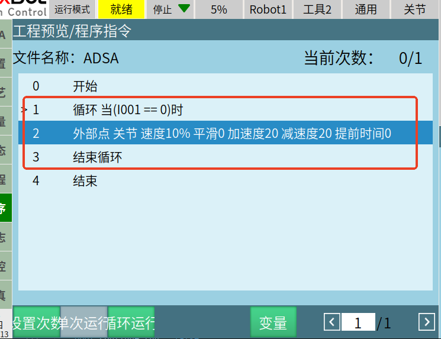

# Tracking Motion with servo_move()

`servo_move(SOCKETFD socketFd, ServoMovePara servoMove)` can receive a set of points, then smooth the received points based on `timeStamp` and dispatch them to the servo for motion.

```cpp
struct ServoMovePara {
  ///< Transfer parameters
  bool clearBuffer;                         ///< Whether to clear previously sent points that haven't started interpolation
  int targetMode;                           ///< 0-discrete points 1-continuous trajectory
  int sendMode;                             ///< 0-send all trajectory points at once 1-send partial points at a time
  int runMode;                              ///< 0-start motion after receiving all 1-start motion while receiving
  int sum;                                  ///< Total number of transfers
  int count;                                ///< Current transfer number
  ///< Motion parameters
  int coord;                                ///< 0-joint 1-Cartesian
  int size;                                 ///< Number of points in this transfer
  std::vector<std::vector<double>> pos;     ///< 2D array: first dimension = number of points in this transfer, second dimension = 7 for joint angles or Cartesian coordinates
  std::vector<std::vector<double>> axisvel; ///< 2D array: first dimension = number of points in this transfer, second dimension = 7 for axis velocities
  std::vector<std::vector<double>> axisacc; ///< 2D array: first dimension = number of points in this transfer, second dimension = 7 for axis accelerations
  std::vector<double> timeStamp;            ///< Length = number of points in this transfer, representing the time to reach each point, in ms
};
```

## Prerequisites: A Job File Must Be Running

`servo_move()` cannot be used on its own: the controller needs a **job running**, and that job must contain an external point (servo tracking) instruction — only then are the points sent by the host over port 7000 executed.

The typical usage is to embed a **host-generated real-time trajectory** inside **one fixed process flow**: the job file owns the flow skeleton (home, pick, place, IO sequencing and other fixed actions), and in the segment that has to follow sensor / vision results the host generates the points in real time and sends them with `servo_move()`.



Start this job file on the teach pendant first, then send points from the host with `servo_move()`.

## Parameter Values (per the header comments)

| Parameter       | Value                             | Meaning                                                                     |
| --------------- | --------------------------------- | --------------------------------------------------------------------------- |
| `targetMode`    | 0 / 1                             | 0-discrete points, 1-continuous trajectory                                  |
| `sendMode`      | 0 / 1                             | 0-send all trajectory points at once, 1-send partial points at a time       |
| `runMode`       | 0 / 1                             | 0-start motion after receiving all, 1-start motion while receiving          |
| `coord`         | 0 / 1                             | 0-joint, 1-Cartesian                                                        |
| `clearBuffer`   | true / false                      | Whether to clear previously sent points that have not started interpolation |

Both examples below use `targetMode = 0` (discrete points) and `sendMode = 0` (send all points of the frame at once); set `targetMode` to 1 if the points should be joined into a continuous trajectory.

### Example 1: Remote Operation by Sending Points Frame by Frame

```cpp
#include <iostream>
#include <vector>
#include <chrono>
#include "cpp_interface/nrc_api.h"


int main() {
  ServoMovePara param;


  // Target point data
  double axis1_pos = 1;
  double axis2_pos = 2;
  
  // Query position before motion
  std::vector<double> pos(7);
  get_current_position(fd, 0, pos);
  std::cout << "Joint position before motion: " << pos[0] << " " << pos[1] << " " << pos[2] << " " 
            << pos[3] << " " << pos[4] << " " << pos[5] << " "  << pos[6] << std::endl;
  
  for (int k = 0; k < 4000; k++) {
      // Generate target point data
      for (int i = 0; i < 2; i++) {
          param.pos.push_back({pos[0], pos[1], pos[2], pos[3], pos[4], pos[5], pos[6]});      // Target point data
          std::cout << "Joint angle=" << param.pos[i][6] << std::endl;
  
          if (k < 100) {
              pos[5] += 0.05;
          } else if (k >= 100 && k < 200) {
              pos[5] -= 0.05;
          } else if (k >= 200 && k < 300) {
              pos[5] += 0.05;
          } else {
              pos[5] -= 0.05;
          }
  
          std::cout << "k=" << k << std::endl;
      }
  
      std::cout << "Size=" << param.pos.size() << std::endl;
  
      // Set velocity for each axis
      for (int i = 0; i < param.pos.size(); i++) {
          param.axisvel.push_back({1, 1, 1, 1, 1, 50, 1});     // Velocity for each axis to reach the target point, in degrees per second
      }
  
      // Set acceleration for each axis
      for (int i = 0; i < param.pos.size(); i++) {
          param.axisacc.push_back({1, 1, 1, 1, 1, 50, 1});       // Acceleration for each axis to reach the target point
      }
  
      // Set timestamps
      double times = 5;     // Time relative to the starting point when reaching this point
      for (int i = 0; i < param.pos.size(); i++) {
          param.timeStamp.push_back(times);
          times += 5;        // Assume each subsequent point is 5ms later than the previous one. Final timeStamp array = {5, 10, 15, 20...}
      }
  
      // Set parameters
      param.clearBuffer = true;  // Clear the points of the previous frame that have not started interpolation
      param.targetMode = 0;   // 0-discrete points, 1-continuous trajectory
      param.sendMode = 0;     // 0-send all trajectory points at once, 1-send partial points at a time
      param.runMode = 0;      // 0-start motion after receiving all, 1-start motion while receiving
      param.coord = 0;        // Joint coordinates
      param.sum = 100000;        // Since points need to be sent continuously, assume a very large total transfer count
      param.count = 100000;        // Since points need to be sent continuously, assume a very large total transfer count
      param.extMove = 0;
      param.size = param.pos.size();
  
      // Call the motion interface
      auto t_start = std::chrono::high_resolution_clock::now();
      std::cout << "servo_move return: " << servo_move(fd, param) << std::endl;
  
      auto t_stop = std::chrono::high_resolution_clock::now();
      auto t_duration = std::chrono::duration<double>(t_stop - t_start);
      std::cout << "t_duration: " << t_duration.count() << std::endl;
  
      // Delay compensation
      if (t_duration.count() < times / 1000 + 0.01) {
          std::this_thread::sleep_for(std::chrono::duration<double>(times / 1000 + 0.01 - t_duration.count()));
      }
  
      // Clear parameters
      param.pos.clear();
      param.axisvel.clear();
      param.axisacc.clear();
      param.timeStamp.clear();
  }
  return 0;
}
```

### Example 2: Using Discrete Point Trajectory, Sending All Trajectory Points at Once (No Smoothing)

```cpp
#include <iostream>
#include <vector>
#include <chrono>
#include "cpp_interface/nrc_api.h"


int main() {
  ServoMovePara param;


// Target point data
double axis1_pos = 1;
double axis2_pos = 2;


// Query position before motion
std::vector<double> pos(7);
get_current_position(fd, 0, pos);
std::cout << "Joint position before motion: " 
          << pos[0] << " " << pos[1] << " " << pos[2] << " " 
          << pos[3] << " " << pos[4] << " " << pos[5] << " " 
          << pos[6] << std::endl;


for (int k = 0; k < 4000; k++) {
    // Generate target point data
    for (int i = 0; i < 2; i++) {
        param.pos.push_back({pos[0], pos[1], pos[2], pos[3], pos[4], pos[5], pos[6]});      // Target point data
        std::cout << "Joint angle=" << param.pos[i][6] << std::endl;


        if (k < 100) {
            pos[5] += 0.05;
        } else if (k >= 100 && k < 200) {
            pos[5] -= 0.05;
        } else if (k >= 200 && k < 300) {
            pos[5] += 0.05;
        } else {
            pos[5] -= 0.05;
        }


        std::cout << "k=" << k << std::endl;
    }


    std::cout << "Size=" << param.pos.size() << std::endl;


    // Set velocity for each axis
    for (int i = 0; i < param.pos.size(); i++) {
        param.axisvel.push_back({1, 1, 1, 1, 1, 50, 1});     // Velocity for each axis to reach the target point, in degrees per second
    }


    // Set acceleration for each axis
    for (int i = 0; i < param.pos.size(); i++) {
        param.axisacc.push_back({1, 1, 1, 1, 1, 50, 1});       // Acceleration for each axis to reach the target point
    }


    // Set timestamps
    double times = 5;     // Time relative to the starting point when reaching this point
    for (int i = 0; i < param.pos.size(); i++) {
        param.timeStamp.push_back(times);
        times += 5;        // Assume each subsequent point is 5ms later than the previous one. Final timeStamp array = {500, 550, 600, 650...}
    }


    // Set parameters
    param.robotNum = 1;
    param.clearBuffer = true;  // Clear the points of the previous frame that have not started interpolation
    param.targetMode = 0;   // 0-discrete points, 1-continuous trajectory
    param.sendMode = 0;     // 0-send all trajectory points at once, 1-send partial points at a time
    param.runMode = 0;      // 0-start motion after receiving all, 1-start motion while receiving
    param.coord = 0;        // Joint coordinates
    param.size = param.pos.size();
    // Call the motion interface
    std::cout << "servo_move return: " << servo_move(fd, param) << std::endl;
    // Delay 5ms
    std::this_thread::sleep_for(std::chrono::milliseconds(5));


    // Clear parameters
    param.pos.clear();
    param.axisvel.clear();
    param.axisacc.clear();
    param.timeStamp.clear();
}
  return 0;
}


```
