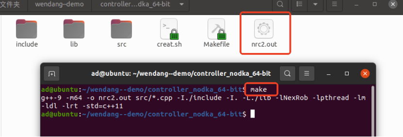
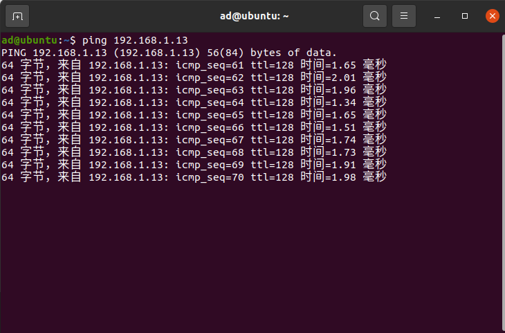

# Quick Start

## 1. Environment Installation

### 1.1 System Requirements

The currently recommended development environment operating system is Ubuntu 20.04.

Two teach pendant models are available, T30 and T40. They use different cross-compilation kits, and **a program built with one kit cannot be used on the other model**. Confirm the target model first, then select the Qt compilation kit from the table below:

| Target                                | Model | Qt compilation kit          | Installation |
| ------------------------------------- | ----- | --------------------------- | ------------ |
| Ubuntu 20.04 host (UI debugging only) | —     | Desktop Qt 5.9.0 GCC 64 bit | See 1.3.1    |
| Embedded teach pendant box            | T30   | LYX                         | See 1.3.2    |
| Embedded teach pendant box            | T40   | t113 cross-compilation kit  | See 1.3.3    |

If you only need to run on the Ubuntu 20.04 host and do not deploy to a physical teach pendant, select the Desktop Qt 5.9.0 GCC 64 bit compilation kit. If you need to deploy to a physical teach pendant, select the LYX kit (T30) or the t113 cross-compilation kit (T40) according to the model.

We provide an image file packed with all development environments. You can also install it on any Ubuntu 20.04 machine by referring to section "1.3 Compilation Kit Installation".

> Directly obtain a pre-configured virtual machine
> Click here to download a VirtualBox-based Ubuntu 20.04.1 virtual machine pre-configured with the development environment;
> Click here to download the VirtualBox software installer for Windows systems. For other system versions, please visit the VirtualBox official website to download.
> .
> Install VirtualBox software (note: the installation path must not contain Chinese characters)
> .
> Open the downloaded "Development Environment Virtual Machine" folder and install the virtual machine according to the instructions in the "README.txt" file;
> .
> After booting, log in with the account "nbt" and password "123".

### 1.2 Qt Download

We need to visit Qt's official website Qt Downloads and select qt-opensource-linux-x64-5.9.0.run to download.

> It is recommended to copy this link https://download.qt.io/archive/qt/5.9/5.9.0/qt-opensource-linux-x64-5.9.0.run and use Thunder for faster download speeds.

What you download here is the **Qt desktop development package**: it provides the Qt Creator IDE (and the local Qt 5.9.0 libraries for Desktop debugging), but **it is not a cross-compilation toolchain itself**. 

After downloading, open the terminal in Ubuntu 20.04 and run:

```bash
sudo chmod a+x qt-opensource-linux-x64-5.9.0.run
sudo ./qt-opensource-linux-x64-5.9.0.run
```

When the Qt installer appears, keep choosing default options until you reach the step where you need to check the options as shown in the image:



After all steps are completed, Qt will be installed in the /opt directory.

To launch Qt, run:

```text
/opt/Qt5.9.0/Tools/QtCreator/bin/qtcreator
```

### 1.3 Compilation Kit Installation

Choose to install the following compilation toolchains based on the specific target platform:

#### 1.3.1 Desktop Qt 5.9.0 GCC 64 bit Compilation Kit Installation

Install GCC, run:

```bash
sudo apt install gcc-multilib
sudo apt install g++-multilib
sudo apt install lib32z1
sudo apt install libgl1-mesa-dev
```

#### 1.3.2 LYX Compilation Kit Installation (T30)

The T30 teach pendant box uses the LYX compilation kit.

Extract gcc.tar.gz and qtenv.tar.gz to the /opt directory of the system:

```bash
sudo tar -zxvf gcc.tar.gz -C /opt
sudo tar -zxvf qtenv.tar.gz -C /opt
```

Extract tslib.tar.gz to the /usr/local directory of the system:

```bash
sudo tar -zxvf tslib.tar.gz -C /usr/local
```

Configure the 32-bit compilation environment:

```bash
sudo dpkg --add-architecture i386
sudo apt update
sudo apt install libc6-dev-i386
sudo apt install g++-multilib
sudo apt install libstdc++6:i386
```

Open Qt and add the LYX compilation kit. For detailed steps, see the attachment:



#### 1.3.3 T40 Compilation Kit Installation

The T40 teach pendant box uses the t113 platform cross-compilation toolchain. The target-side Qt 5.12.5 required by T40 **is part of this toolchain** and ships with it (under `Qt_5.12.5-install/` inside the toolchain), so no separate target-side Qt installation is needed. The T40 and T30 kits are **not interchangeable**: a program built for one model cannot be used on the other.

The toolchain is provided by technical support and packaged in `t113-M4-Qt5.12.zip`. The package contains:

```text
t113-M4-Qt5.12.zip
└── t113-M4
    ├── t113_m4-Toolchain.tar.gz         # Cross-compilation toolchain (used in this section)
    ├── t113_m4-image.zip                # Teach pendant system image (for flashing, not this section)
    ├── T113-xPad-v5烧写固件及测试网络.pdf
    └── 交叉编译工具链使用.pdf
```

**Step 1 - Extract the toolchain**

Extract `t113-M4-Qt5.12.zip` to get the `t113-M4/` folder, then extract t113_m4-Toolchain.tar.gz inside it and enter the extracted folder:

```bash
tar -xzf t113_m4-Toolchain.tar.gz
cd t113_m4-Toolchain
```

The extracted layout matters, because all kit paths point into it:

```text
t113_m4-Toolchain
├── cross-compile-qtdepend
│   ├── Qt_5.12.5-install/bin/qmake                    # qmake of the target-side Qt 5.12.5
│   └── toolchain/bin/arm-linux-gnueabi-gcc            # Cross-compilation toolchain
└── qt-test-demo                                       # Sample project for verifying the toolchain
```

**Step 2 - Create the /opt symbolic link**

Link cross-compile-qtdepend from the toolchain into `/opt`. **The path and folder name must stay as `/opt/cross-compile-qtdepend`**; the kit configuration refers to this fixed path, and compilation fails if the folder is renamed.

```bash
sudo ln -s ${PWD}/cross-compile-qtdepend /opt/cross-compile-qtdepend
```

**Step 3 - Start Qt Creator with the environment variables set**

Export the two variables needed for cross compilation in the current terminal, then start Qt Creator. Run the three commands in order:

```bash
export ARCH=arm
export CROSS_COMPILE=/opt/cross-compile-qtdepend/toolchain/bin/arm-linux-gnueabi-
/opt/Qt5.9.0/Tools/QtCreator/bin/qtcreator
```

> **Note**: The environment variables only apply to the current terminal. Every time you open a new terminal and start Qt Creator, run the two `export` commands again; otherwise the T40 kit reports that no compiler is found.

**Step 4 - Add the T40 kit in Qt Creator**

Open Qt Creator, click Projects on the left, then click Manage Kits at the top left, and add a kit. Fill in the three compilers as shown below:

| Kit field | Value                                                             |
| --------- | ----------------------------------------------------------------- |
| qmake     | `/opt/cross-compile-qtdepend/Qt_5.12.5-install/bin/qmake`         |
| gcc-c++   | `/opt/cross-compile-qtdepend/toolchain/bin/arm-linux-gnueabi-g++` |
| gcc-c     | `/opt/cross-compile-qtdepend/toolchain/bin/arm-linux-gnueabi-gcc` |

Name the kit T40 so that it is easy to distinguish from the LYX kit of T30 when switching the build target.

> **Deploying to T40**: T40 and T30 use different kits, so their build outputs are not interchangeable and their runtime startup parameters are not necessarily the same either. When copying the build output to T40, follow the startup script under `/userfs/app/` on the actual device instead of reusing the T30 startup command in Section 2.
>
> **If compilation reports missing 32-bit libraries**: add i386 architecture support by following "Configure the 32-bit compilation environment" in 1.3.2. The steps are identical for T30 and T40.

**Step 5 - Verify the toolchain (optional)**

The toolchain package includes a sample project, `qt-test-demo`, which you can use to confirm that cross compilation works. Export the environment variables from Step 3 first, then run:

```bash
cd qt-test-demo/
/opt/cross-compile-qtdepend/Qt_5.12.5-install/bin/qmake
make -j8
```

If ARM objects are produced, the toolchain is working. On failure, re-check the symbolic link path in Step 2 and the environment variables in Step 3.

At this point, the three commonly used compilation kits (Desktop for host debugging, LYX for T30, t113 for T40) are configured. Use the one that matches your target platform.

## 2. Remote Login to Teach Pendant

### 2.1 Confirm the Computer is Connected to the Teach Pendant

First, ensure that your computer has established communication with the controller. The computer's IP needs to be in the same network segment as the controller's IP. The factory default IP of the teach pendant is 192.168.1.245, so the network port of the computer connecting to the controller also needs to be set to the 1-network segment (for example, you can set 192.168.1.110). After configuration, open a new terminal in Ubuntu and enter:

```bash
ping 192.168.1.245
```

If unsuccessful, check the network cable connection, the computer's IP, and the teach pendant's IP.

### 2.2 Log in to the Teach Pendant Using SSH

```bash
ssh root@192.168.1.245
```

Then enter the password 1234 to gain remote control.

The teach pendant program runs in /userfs/app/. Use ./Qt-tp -qws to start the teach pendant program, and use killall -9 Qt-tp to terminate the teach pendant program.
