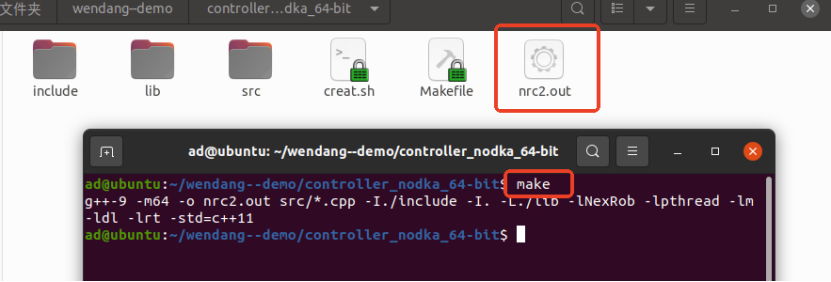
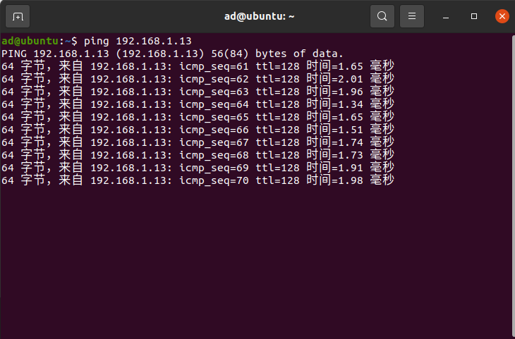

# 빠른 시작

## 1. 환경 설치

### 1.1 시스템 요구사항

현재 권장되는 개발 환경 운영체제는 Ubuntu 20.04입니다.

티치 펜던트는 T30과 T40 두 가지 모델이 있으며, 두 모델은 서로 다른 크로스 컴파일 키트를 사용합니다. **한쪽 키트로 빌드한 프로그램을 다른 모델에서 사용할 수 없습니다.** 먼저 배포할 모델을 확인한 후 아래 표에 따라 Qt 컴파일 키트를 선택하십시오:

| 실행 대상                           | 모델 | Qt 컴파일 키트              | 설치 방법  |
| ----------------------------------- | ---- | --------------------------- | ---------- |
| Ubuntu 20.04 호스트(UI 디버깅 전용) | —    | Desktop Qt 5.9.0 GCC 64 bit | 1.3.1 참조 |
| 임베디드 티치 펜던트 박스           | T30  | LYX                         | 1.3.2 참조 |
| 임베디드 티치 펜던트 박스           | T40  | t113 크로스 컴파일 키트     | 1.3.3 참조 |

Ubuntu 20.04 호스트에서만 실행하고 임베디드 티치 펜던트에 배포하지 않을 경우 Desktop Qt 5.9.0 GCC 64 bit 컴파일 키트를 선택하십시오. 임베디드 티치 펜던트에 배포할 경우 모델에 따라 LYX(T30) 또는 t113 크로스 컴파일 키트(T40)를 선택하십시오.

모든 개발 환경이 패키징된 이미지 파일을 제공합니다. 물론 임의의 Ubuntu 20.04에서 《1.3 컴파일 키트 설치》 섹션을 참조하여 설치할 수도 있습니다.

> 개발 환경이 구성된 가상 머신 직접 받기
> 여기를 클릭하여 VirtualBox 기반 Ubuntu 20.04.1 시스템 가상 머신을 다운로드할 수 있습니다;
> 여기를 클릭하여 Windows용 VirtualBox 설치 패키지를 다운로드할 수 있으며, 다른 OS 버전이 필요한 경우 VirtualBox 공식 사이트에서 직접 다운로드하십시오.
> •
> VirtualBox 소프트웨어 설치 (설치 경로에 중국어가 포함되지 않도록 주의)
> •
> 다운로드한 "개발 환경 가상 머신" 폴더를 열고 "README.txt" 파일 설명에 따라 가상 머신을 설치합니다;
> •
> 부팅 후 "nbt" 계정으로 로그인, 비밀번호는 "123"입니다.

### 1.2 Qt 다운로드

Qt 공식 사이트 Qt Downloads에서 qt-opensource-linux-x64-5.9.0.run을 선택하여 다운로드해야 합니다.

> https://download.qt.io/archive/qt/5.9/5.9.0/qt-opensource-linux-x64-5.9.0.run 링크를 복사하여 Xunlei로 다운로드하면 더 빠릅니다.

여기에서 다운로드하는 것은 **Qt 데스크톱 개발 패키지**로, Qt Creator 개발 도구(와 호스트 Desktop 디버깅용 Qt 5.9.0 라이브러리)를 제공하며 **그 자체가 크로스 컴파일 툴체인은 아닙니다**. 

다운로드 완료 후 Ubuntu 20.04에서 cmd를 열고 실행:

```bash
sudo chmod a+x qt-opensource-linux-x64-5.9.0.run
sudo ./qt-opensource-linux-x64-5.9.0.run
```

Qt 설치 프로그램이 나타나면 계속 기본값을 선택하고, 다음 단계에서 그림과 같이 옵션을 선택해야 합니다:



모든 단계가 완료되면 Qt는 /opt 디렉터리에 설치됩니다.

Qt 시작, 실행:

```text
/opt/Qt5.9.0/Tools/QtCreator/bin/qtcreator
```

### 1.3 컴파일 키트 설치

다음 컴파일 체인은 구체적인 대상 플랫폼에 따라 선택 설치합니다:

#### 1.3.1 Desktop Qt 5.9.0 GCC 64 bit 컴파일 키트 설치

GCC 설치, 실행:

```bash
sudo apt install gcc-multilib
sudo apt install g++-multilib
sudo apt install lib32z1
sudo apt install libgl1-mesa-dev
```

#### 1.3.2 LYX 컴파일 키트 설치 (T30)

T30 티치 펜던트 박스는 LYX 컴파일 키트를 사용합니다.

gcc.tar.gz와 qtenv.tar.gz를 시스템의 /opt/ 디렉터리에 압축 해제합니다

```bash
sudo tar -zxvf gcc.tar.gz -C /opt
sudo tar -zxvf qtenv.tar.gz -C /opt
```

tslib.tar.gz를 시스템의 /usr/local 디렉터리에 압축 해제합니다

```bash
sudo tar -zxvf tslib.tar.gz -C /usr/local
```

32비트 컴파일 환경 구성

```bash
sudo dpkg --add-architecture i386
sudo apt update
sudo apt install libc6-dev-i386
sudo apt install g++-multilib
sudo apt install libstdc++6:i386
```

Qt를 열고 LYX 컴파일 키트를 추가합니다. 자세한 단계는 첨부 파일을 참조하십시오:



#### 1.3.3 T40 컴파일 키트 설치

T40 티치 펜던트 박스는 t113 플랫폼 크로스 컴파일 툴체인을 사용합니다. T40에 필요한 대상 측 Qt 5.12.5는 **이 툴체인의 일부**로 함께 제공되며(툴체인 내부의 `Qt_5.12.5-install/`), 대상 측 Qt를 별도로 설치할 필요가 없습니다. T40과 T30의 키트는 **호환되지 않으며**, 한 모델용으로 빌드한 프로그램을 다른 모델에서 사용할 수 없습니다.

툴체인은 기술 지원팀에서 제공하며 `t113-M4-Qt5.12.zip`에 패키징되어 있습니다. 패키지 구성은 다음과 같습니다(T113 펌웨어 이미지와 사용 설명 PDF 포함):

```text
t113-M4-Qt5.12.zip
└── t113-M4
    ├── t113_m4-Toolchain.tar.gz         # 크로스 컴파일 툴체인 (이 절에서 사용)
    ├── t113_m4-image.zip                # 티치 펜던트 시스템 이미지 (라팅용, 이 절과 무관)
    ├── T113-xPad-v5烧写固件及测试网络.pdf
    └── 交叉编译工具链使用.pdf
```

**1단계 · 툴체인 압축 해제**

`t113-M4-Qt5.12.zip`을 압축 해제하여 `t113-M4/` 디렉터리를 얻은 후, 그 안의 t113_m4-Toolchain.tar.gz를 다시 압축 해제하고 압축이 풀린 디렉터리로 이동합니다:

```bash
tar -xzf t113_m4-Toolchain.tar.gz
cd t113_m4-Toolchain
```

압축 해제 후의 디렉터리 구조가 중요합니다. 키트 경로가 모두 이 구조를 가리킵니다:

```text
t113_m4-Toolchain
├── cross-compile-qtdepend
│   ├── Qt_5.12.5-install/bin/qmake                    # 대상 측 Qt 5.12.5의 qmake
│   └── toolchain/bin/arm-linux-gnueabi-gcc            # 크로스 컴파일 툴체인
└── qt-test-demo                                       # 툴체인 검증용 샘플 프로젝트
```

**2단계 · /opt 심볼릭 링크 생성**

툴체인 안의 cross-compile-qtdepend를 `/opt` 아래에 링크합니다. **경로와 폴더 이름은 반드시 `/opt/cross-compile-qtdepend`로 유지해야 합니다.** 키트 설정이 이 고정 경로를 사용하므로 이름을 바꾸면 컴파일 시 툴체인을 찾지 못합니다.

```bash
sudo ln -s ${PWD}/cross-compile-qtdepend /opt/cross-compile-qtdepend
```

**3단계 · 환경 변수를 설정한 상태로 Qt Creator 실행**

현재 터미널에서 크로스 컴파일에 필요한 두 변수를 export한 후 Qt Creator를 실행합니다. 세 명령을 순서대로 실행하십시오:

```bash
export ARCH=arm
export CROSS_COMPILE=/opt/cross-compile-qtdepend/toolchain/bin/arm-linux-gnueabi-
/opt/Qt5.9.0/Tools/QtCreator/bin/qtcreator
```

> **주의**: 환경 변수는 현재 터미널에만 적용됩니다. 새 터미널을 열어 Qt Creator를 실행할 때마다 위의 `export` 두 줄을 다시 실행해야 하며, 그렇지 않으면 T40 키트에서 컴파일러를 찾을 수 없다는 오류가 발생합니다.

**4단계 · Qt Creator에서 T40 키트 추가**

Qt Creator를 열고 왼쪽의 [프로젝트]를 클릭한 다음 왼쪽 위의 [키트 관리 Manage Kits]를 클릭하여 키트를 추가하고, 세 가지 컴파일러 경로를 아래 표와 같이 입력합니다:

| 키트 항목 | 입력 내용                                                         |
| --------- | ----------------------------------------------------------------- |
| qmake     | `/opt/cross-compile-qtdepend/Qt_5.12.5-install/bin/qmake`         |
| gcc-c++   | `/opt/cross-compile-qtdepend/toolchain/bin/arm-linux-gnueabi-g++` |
| gcc-c     | `/opt/cross-compile-qtdepend/toolchain/bin/arm-linux-gnueabi-gcc` |

키트 이름은 T40으로 지정하여 T30의 LYX 키트와 구분하면 빌드 대상 전환 시 혼동을 줄일 수 있습니다.

> **T40 배포**: T40과 T30은 키트가 달라 빌드 결과물을 서로 바꿔 사용할 수 없으며, 실행 단계의 시작 매개변수도 반드시 동일하지는 않습니다. 빌드 결과물을 T40에 배포할 때는 실기기의 `/userfs/app/` 아래 시작 스크립트를 기준으로 하십시오. 2장의 T30 시작 명령을 그대로 사용하지 마십시오.
>
> **컴파일 시 32비트 라이브러리가 없다는 메시지가 나오면**: 1.3.2의 "32비트 컴파일 환경 구성"에 따라 i386 아키텍처 지원을 추가하십시오. T30과 T40의 절차는 동일합니다.

**5단계 · 툴체인 검증 (선택)**

툴체인 패키지에는 샘플 프로젝트 `qt-test-demo`가 포함되어 있어 크로스 컴파일이 정상 동작하는지 확인할 수 있습니다. 먼저 3단계대로 환경 변수를 export한 후 실행합니다:

```bash
cd qt-test-demo/
/opt/cross-compile-qtdepend/Qt_5.12.5-install/bin/qmake
make -j8
```

ARM 오브젝트 파일이 정상 생성되면 툴체인을 사용할 수 있습니다. 오류가 나면 2단계의 심볼릭 링크 경로와 3단계의 환경 변수를 다시 확인하십시오.

이제 Desktop(호스트 디버깅), LYX(T30), t113(T40) 세 가지 컴파일 키트 구성이 완료되었습니다. 대상 플랫폼에 맞는 키트를 선택하여 사용하십시오.

## 2. 티치 펜던트에 원격 로그인

### 2.1 컴퓨터가 티치 펜던트에 연결되었는지 확인

먼저 컴퓨터가 컨트롤러와 통신 연결되었는지 확인하십시오. 컴퓨터의 IP는 컨트롤러의 IP와 동일한 네트워크 세그먼트에 있어야 합니다. 티치 펜던트의 공장 출하 기본 IP는 192.168.1.245이므로, 컴퓨터에서 컨트롤러의 네트워크 포트에 연결할 때도 1번 세그먼트로 설정해야 합니다 (예: 192.168.1.110). 설정 완료 후 Ubuntu에서 새 터미널을 열고 입력:

```bash
ping 192.168.1.245
```

실패하는 경우 네트워크 케이블 연결, 컴퓨터 IP, 티치 펜던트 IP를 확인하십시오.

### 2.2 ssh를 사용하여 티치 펜던트에 로그인

```bash
ssh root@192.168.1.245
```

그런 다음 비밀번호로 1234를 입력하면 원격 제어가 가능합니다.

티치 펜던트 프로그램은 /userfs/app/에서 실행되며, ./Qt-tp -qws로 티치 펜던트 프로그램을 시작하고, killall -9 Qt-tp로 티치 펜던트 프로그램을 종료합니다.
