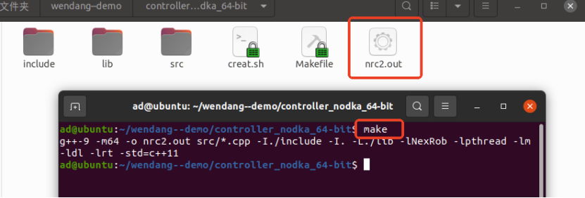
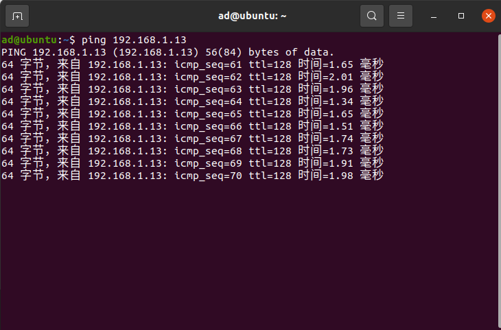

## 1. 环境安装

### 1.1 系统要求

当前推荐的开发环境操作系统为 Ubuntu 20.04。

示教器现有 T30、T40 两个型号，两者使用的交叉编译套件不同，**用一套套件编出来的程序不能在两个型号之间通用**。请先确认要部署的型号，再按下表选择 Qt 编译套件：

| 运行目标                        | 型号 | Qt 编译套件                 | 安装方法 |
| ------------------------------- | ---- | --------------------------- | -------- |
| Ubuntu 20.04 本机（仅界面调试） | —    | Desktop Qt 5.9.0 GCC 64 bit | 见 1.3.1 |
| 实体示教盒                      | T30  | LYX                         | 见 1.3.2 |
| 实体示教盒                      | T40  | t113 交叉编译套件           | 见 1.3.3 |

只需要在 Ubuntu 20.04 上运行、不部署到实体示教盒时，选择 Desktop Qt 5.9.0 GCC 64 bit 编译套件；需要部署到实体示教盒时，按型号选 LYX（T30）或 t113 交叉编译套件（T40）。

我们提供打包了所有开发环境的镜像文件，当然也可以在任意一台 Ubuntu 20.04 下参照小节《1.3 编译套件安装》来安装。

> 直接获取安装好了的虚拟机
> 点击这里 可以下载得到配置好开发环境的、基于 VirtualBox 软件使用的 Ubuntu 20.04.1 系统的虚拟机;
> 点击这里 可以下载得到基于 Windows 系统的 VirtualBox 软件安装包，如需其他系统版本的请自行到 VirtualBox 官网 进行下载。
> •
> 安装 VirtualBox 软件（注意按转路径不能带有中文）
> •
> 打开下载的"开发环境虚拟机"文件夹，按照"README.txt"文件说明安装虚拟机;
> •
> 开机后登录账户"nbt"，密码是"123"。

### 1.2 Qt 下载

我们需要进入 Qt 的官网 Qt Downloads 选择 qt-opensource-Linux-x64-5.9.0.run 下载。

> 推荐复制这个链接 [https://download.qt.io/archive/qt/5.9/5.9.0/qt-opensource-linux-x64-5.9.0.run]，打开迅雷下载速度更快。

本节下载安装的是 **Qt 的桌面开发包**，提供的是 Qt Creator 开发工具（以及本机 Desktop 调试用的 Qt 5.9.0 库），**它本身不是交叉编译工具链**。

下载完成后在 Ubuntu 20.04中，打开 cmd，运行：

```bash
sudo chmod a+x qt-opensource-linux-x64-5.9.0.run
sudo ./qt-opensource-linux-x64-5.9.0.run
```

出现 qt 安装程序后⼀直选择默认，直到这⼀步需要勾选如图所⽰的选项：



步骤全部完成后，Qt 会被安装到/opt 目录下。

启动 Qt，运行：

```text
/opt/Qt5.9.0/Tools/QtCreator/bin/qtcreator
```

### 1.3 编译套件安装

以下编译链根据具体的目标平台选择安装：

#### 1.3.1 Desktop Qt 5.9.0 GCC 64 bit 编译套件安装

安装 GCC，运行：

```bash
sudo apt install gcc-multilib
sudo apt install g++-multilib
sudo apt install lib32z1
sudo apt install libgl1-mesa-dev
```

#### 1.3.2 LYX 编译套件安装（T30）

T30 示教盒使用 LYX 编译套件。

将 gcc.tar.gz 和 qtenv.tar.gz 解压到系统的/opt/⽬录下

```bash
sudo tar -zxvf gcc.tar.gz -C /opt
sudo tar -zxvf qtenv.tar.gz -C /opt
```

将 tslib.tar.gz 解压到系统的/usr/local⽬录下

```bash
sudo tar -zxvf tslib.tar.gz -C /usr/local
```

配置 32 位编译环境

```bash
sudo dpkg --add-architecture i386
sudo apt update
sudo apt install libc6-dev-i386
sudo apt install g++-multilib
sudo apt install libstdc++6:i386
```

打开 qt，添加 LYX 编译套件，详细步骤可⻅附件：



#### 1.3.3 T40 编译套件安装

T40 示教盒使用 t113 平台的交叉编译工具链。T40 需要的目标端 Qt 5.12.5 **是这条工具链的一部分**，随工具链一起提供（位于工具链内的 `Qt_5.12.5-install/`），不需要另外安装目标平台的 Qt。T40 与 T30 的套件**不通用**，两个型号的编译产物不能互换使用。

工具链由技术支持提供，打包在 `t113-M4-Qt5.12.zip` 中，包内结构如下（另含 T113 烧写固件与使用说明 PDF）：

```text
t113-M4-Qt5.12.zip
└── t113-M4
    ├── t113_m4-Toolchain.tar.gz         # 交叉编译工具链（本节使用）
    ├── t113_m4-image.zip                # 示教盒系统镜像（烧写用，非本节内容）
    ├── T113-xPad-v5烧写固件及测试网络.pdf
    └── 交叉编译工具链使用.pdf
```

**步骤 1 · 解压工具链**

解压 `t113-M4-Qt5.12.zip`，得到 `t113-M4/` 目录；再解压其中的 t113_m4-Toolchain.tar.gz，然后进入解压出来的目录：

```bash
tar -xzf t113_m4-Toolchain.tar.gz
cd t113_m4-Toolchain
```

解压后的目录结构是关键，后续套件路径都指向这里：

```text
t113_m4-Toolchain
├── cross-compile-qtdepend
│   ├── Qt_5.12.5-install/bin/qmake                    # 目标端 Qt 5.12.5 的 qmake
│   └── toolchain/bin/arm-linux-gnueabi-gcc            # 交叉编译工具链
└── qt-test-demo                                       # 用于验证工具链的示例工程
```

**步骤 2 · 建立 /opt 软链接**

把工具链里的 cross-compile-qtdepend 链接到 `/opt` 下。**路径和文件夹名必须保持为 `/opt/cross-compile-qtdepend`**，套件配置用的是这个固定路径，改名后编译会找不到工具链。

```bash
sudo ln -s ${PWD}/cross-compile-qtdepend /opt/cross-compile-qtdepend
```

**步骤 3 · 带环境变量启动 Qt Creator**

先在当前终端导出交叉编译需要的两个变量，再启动 Qt Creator，三条命令按顺序执行：

```bash
export ARCH=arm
export CROSS_COMPILE=/opt/cross-compile-qtdepend/toolchain/bin/arm-linux-gnueabi-
/opt/Qt5.9.0/Tools/QtCreator/bin/qtcreator
```

> **注意**：环境变量只对当前终端有效。每新开一个终端启动 Qt Creator，都要重新执行上面两行 `export`，否则选中 T40 套件时会报找不到编译器。

**步骤 4 · 在 Qt Creator 中添加 T40 套件**

打开 Qt Creator，点击左侧【项目】，再点击左上角【管理套件 Manage Kits】，添加一个套件，三个编译器路径按下表填写：

| 套件字段 | 填写内容                                                          |
| -------- | ----------------------------------------------------------------- |
| qmake    | `/opt/cross-compile-qtdepend/Qt_5.12.5-install/bin/qmake`         |
| gcc-c++  | `/opt/cross-compile-qtdepend/toolchain/bin/arm-linux-gnueabi-g++` |
| gcc-c    | `/opt/cross-compile-qtdepend/toolchain/bin/arm-linux-gnueabi-gcc` |

套件名称建议写成「T40」，与 T30 的 LYX 套件区分开，切换项目目标时不容易选错。

> **部署到 T40**：T40 与 T30 的套件不同，编译产物不能互换，运行阶段的启动参数也不一定通用。把编译产物放到 T40 时，以实机 `/userfs/app/` 下的启动脚本为准，不要直接套用第 2 章里 T30 的启动命令。
>
> **编译报缺少 32 位库时**：按 1.3.2 中的「配置 32 位编译环境」为系统添加 i386 架构支持，T30 与 T40 相同。

**步骤 5 · 验证工具链（可选）**

工具链包里带了一个示例工程 `qt-test-demo`，可用来确认交叉编译是否配通。先按步骤 3 导出环境变量，然后：

```bash
cd qt-test-demo/
/opt/cross-compile-qtdepend/Qt_5.12.5-install/bin/qmake
make -j8
```

能正常生成 ARM 目标文件即说明工具链可用；报错时先回查步骤 2 的软链接路径与步骤 3 的环境变量。

至此，Desktop（本机调试）、LYX（T30）、t113（T40）三套编译套件就配置完成了，按目标平台择一使用即可。

## 2. 远程登陆到示教器

### 2.1 确认电脑连接上示教器

首先确保你的电脑已经跟控制器连接了通讯，电脑的 IP 需要跟控制器的 IP 在同一网段下。示教器的出厂默认 IP 为192.168.1.245，所以电脑连接控制器的网口同样需要设置为1网段（比如可以设置192.168.1.110）。设置完成之后在 Ubuntu 中打开一个新的终端输入

```bash
ping 192.168.1.245
```

如出现不成功的情况，请检查网线的连接，电脑的 IP，示教器的 IP。

### 2.2 使用 ssh 登陆到示教器

```bash
ssh root@192.168.1.245
```

然后密码输入1234，即可进行远程控制了。

示教器程序执行在/userfs/app/下，使用./Qt-tp -qws 即可启动示教器程序，使用 killall -9 Qt-tp 杀死示教器程序。
